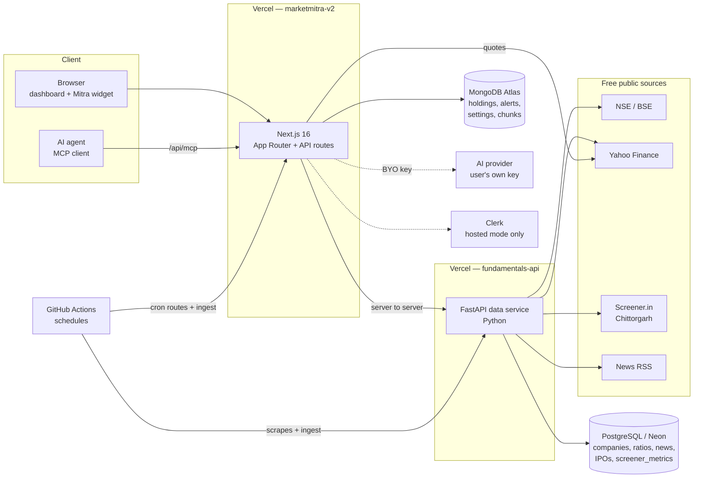

# Architecture

A summary of how MarketMitra is put together. The canonical, always-current reference is [`docs/architecture.md`](https://github.com/AnkushGitRepo/marketmitra/blob/main/docs/architecture.md) in the repository; this page is the orientation.

## System overview

## The two services

| | Next.js app | Fundamentals service |
| --- | --- | --- |
| Path | repo root (`src/`) | `services/fundamentals-api/` |
| Language | TypeScript | Python (FastAPI) |
| Database | MongoDB Atlas (native driver, no ORM) | PostgreSQL via SQLAlchemy |
| Owns | UI, user data, alerts engine, AI orchestration, MCP server | company/market data, news, IPOs, screener tables, embeddings |
| Hosting | Vercel | Vercel (Python function) + Neon |

**Why is there a Python service at all?** The app's backend is Next.js route handlers only — that is a hard rule. The data service is the single, scoped exception ([ADR 0011](Decision-Records), [ADR 0013](Decision-Records)): the data tooling (`nsepython`, `yfinance`, `scrapling`, `fastembed`) exists only in Python. Embeddings also live here because `onnxruntime-node` cannot load on Vercel.

## Three-tier data sourcing

Company data comes through a fallback chain so a blocked source degrades the answer instead of breaking it ([ADR 0011](Decision-Records)):

1. **Tier 1 — exchanges:** NSE (`nsepython`) and BSE (`bsedata`).
2. **Tier 2 — Yahoo Finance:** prices and gap-filling.
3. **Tier 3 — scrapers:** Screener.in (ratios, statements) and Chittorgarh (IPOs, GMP), each in an isolated, swappable module because their terms don't sanction scraping.

Every record that can come from more than one tier carries a `source_tier` field. Full list with rate limits and terms: [Data Sources](Data-Sources).

## Hosted vs self-hosted

A single `isHosted()` helper (`src/lib/deployment-mode.ts`) reads `NEXT_PUBLIC_DEPLOYMENT_MODE`. It controls whether Clerk auth runs (`src/proxy.ts`), whether sign-in pages render, and which landing sections appear. **Feature backends do not check it** — they enable themselves from their own config variables — so self-host is never a reduced product ([ADR 0010](Decision-Records)).

## Request flow

- **Reads:** dashboard Server Components call the data service directly (server-to-server via `FUNDAMENTALS_API_URL`) and MongoDB for user-owned data.
- **Mutations and live reads:** thin same-origin `/api/*` routes (`/api/holdings`, `/api/alerts`, `/api/search`, `/api/screener`, `/api/ai/chat`, …).
- **Live quotes:** `yahoo-finance2` from the app (batched), with NSE/BSE as fallback ([ADR 0024](Decision-Records)).
- **Scheduled work:** GitHub Actions call `/api/cron/*` routes (bearer `CRON_SECRET`) and the data service's ingest endpoints (bearer tokens). See [Operations Runbook](Operations-Runbook).

## Key subsystems

| Subsystem | Summary | Decision |
| --- | --- | --- |
| **Alerts engine** | Evaluated on a schedule; in-app, webhook, email and per-user channels. Includes trailing stops and drawdown guards. | ADR 0014, 0028, 0030 |
| **Screener** | `screener_metrics` table; daily Yahoo quotes + incremental Screener.in fundamentals; shared filter schema for the page, the API and Mitra. | ADR 0025, 0033 |
| **Retrieval (RAG)** | News and filings chunked and embedded (`bge-small-en-v1.5`, 384-dim) into a `chunks` collection with Atlas Vector Search; the chat is an agentic tool-calling loop over it. | ADR 0020 |
| **Multi-agent analysis** | Four analyst agents → bull/bear debate → synthesis; async checkpointed runs. Stops before any trade decision. | ADR 0021 |
| **API + MCP** | Every feature has a documented endpoint; public market data is also an MCP server. Hosted mode has fair-use rate limiting. | ADR 0019 |
| **System status** | Public `/status` and an operator event log at `/dashboard/system`. | ADR 0029 |

## Technology choices

Next.js 16 (App Router, TypeScript) · CSS Modules with design tokens, **no** Tailwind/Bootstrap · Clerk v7 (hosted only) · MongoDB native driver · FastAPI + SQLAlchemy async + Alembic · Vercel · MIT licensed. The reasons are recorded one-by-one in [Decision Records](Decision-Records).

> Heads-up for contributors: this repo uses a Next.js version with breaking changes (for example `proxy.ts` replaces `middleware.ts`). Read the bundled docs in `node_modules/next/dist/docs/` before writing framework code — see the [Development Guide](Development-Guide).
